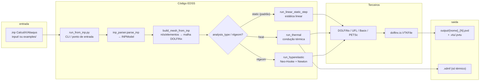

# FeniCS-EDSS — Overview técnico

**Repositório:** https://github.com/valdirmc/Fenics-EDSS  
**Branch analisada:** `dev` @ `ffc9336` (2026-10-21, America/Sao_Paulo)  
**Caminho no box:** `/workspace/Fenics-EDSS`  
**Data deste estudo:** 2026-11-06 (America/Sao_Paulo)  
**Papel no FemEDSS:** terceiro solver FEM (ao lado de CalculiX e OpenCourant), entrada `.inp` estilo CalculiX/Abaqus, saída ParaView (`.pvd`/`.vtu`).

---

## 1. Arquitetura

```
Fenics-EDSS/
├── docker/Dockerfile          # imagem baseada em dolfinx/dolfinx:stable
├── docker-compose.yaml        # serviço fenicsx (sleep infinity + volume .:/app)
├── src/
│   ├── inp_parser.py          # parse do .inp → INPModel
│   ├── run_from_inp.py        # orquestrador + estática linear + malha DOLFINx
│   ├── run_thermal.py         # condução térmica estacionária
│   ├── run_hyper.py           # Neo-Hooke (Newton)
│   └── Test_*.py / test_box.py  # experimentos manuais
├── templates/                 # caminho alternativo: malha gerada + JSON (sem .inp)
├── params/                    # JSON dos templates
├── examples/                  # .inp e .py de demonstração
├── scripts/run_fenics.sh      # roda examples/*.py via docker compose
├── tests/                     # só validação de templates/params (pytest)
└── docs/                      # memória, plano Agile, contrato de integração
```

**Stack de execução**

| Camada | Tecnologia | Evidência |
|--------|------------|-----------|
| Runtime | Docker Compose, imagem `edss/fenicsx:dev` | `docker-compose.yaml`, `docker/Dockerfile` |
| FEM | DOLFINx / UFL / Basix / PETSc / mpi4py | imports em `src/run_from_inp.py` |
| Entrada | `.inp` CalculiX/Abaqus | `src/inp_parser.py`, contrato em `docs/Contrato_Integracao_FemEDSS.md` |
| Saída | `dolfinx.io.VTKFile` → `.pvd` (+ `.xdmf` no térmico) | `run_from_inp.py` L197–200, `run_thermal.py` L82–88 |

**Pontos de entrada**

1. **Produção / FemEDSS-app:**  
   `docker compose run --rm fenicsx python3 /app/src/run_from_inp.py /app/input/caso.inp [-debug=1]`  
   (`docs/Contrato_Integracao_FemEDSS.md`)
2. **Exemplos Python (sem .inp):** `./scripts/run_fenics.sh <exemplo>`
3. **Templates JSON:** `scripts/run_template.sh` + `templates/*.py` (caminho paralelo, não usado pelo contrato `.inp`)

---

## 2. Fluxo de dados (quem faz o quê)

Perguntas do produto:

| Pergunta | Resposta | Arquivo / função |
|----------|----------|------------------|
| Quem **recebe** o `.inp`? | `run_from_inp()` (CLI `run_from_inp.py`) | `src/run_from_inp.py` L337–387 |
| Quem **transforma** em entrada FEniCS/DOLFINx? | `parse_inp` → `INPModel`; `build_mesh_from_inp` monta malha; solvers montam V, formas UFL, BCs e cargas | `inp_parser.parse_inp`, `build_mesh_from_inp`, `run_linear_static_step` / `run_thermal` / `run_hyperelastic` |
| Quem **traduz** resultado FEniCS em VTK/ParaView? | o próprio solver, via `dolfinx.io.VTKFile` → `{output_base}.pvd` | `run_from_inp.py` L197–200; `run_thermal.py` L85–88; `run_hyper.py` L100–103 |

**Não há** etapa intermediária com meshio nem conversor FRD→VTK: a escrita VTK é nativa do DOLFINx.



**Roteamento atual** (`run_from_inp` L362–369):

1. Se `model.analysis_type == "heat"` → `run_thermal`
2. Senão se `step.nlgeom` ou `model.nlgeom` → `run_hyperelastic`
3. Senão → `run_linear_static_step`

> **Bug crítico:** `inp_parser.py` **não** trata `*HEAT TRANSFER`. O exemplo `examples/beam_thermal.inp` contém essa card, mas `analysis_type` permanece `"static"`. Assim, o caminho térmico via `run_from_inp` **não é acionado** na prática. Ver seção 5.

---

## 3. Código próprio (EDSS) vs terceiros

| Componente | Origem | Papel | Evidência |
|------------|--------|-------|-----------|
| `src/inp_parser.py` | **EDSS** | Parser mínimo `.inp` → dataclasses | docstring L1–6 |
| `src/run_from_inp.py` | **EDSS** | Orquestração, malha, estática linear, escrita PVD | — |
| `src/run_thermal.py` | **EDSS** | Solver térmico | — |
| `src/run_hyper.py` | **EDSS** | Solver hiperelástico Neo-Hooke | — |
| `templates/*.py`, `params/*.json` | **EDSS** | Alternativa parametrizada (malha box gerada) | `docs/templates.md` |
| `scripts/*.sh`, `docker/*`, `docs/*` | **EDSS** | Ops e documentação | — |
| `examples/*.inp`, `examples/*.py` | **EDSS** | Casos de demo | — |
| DOLFINx / FFCx / UFL | **Terceiro** (LGPL-3.0+) | FEM core | `docs/Memoria_Projeto_Fenics-EDSS.md` |
| Basix | **Terceiro** (MIT) | Elementos de referência | imports `basix.ufl` |
| PETSc / petsc4py / mpi4py | **Terceiro** | Algebra linear / MPI | imports |
| Imagem `dolfinx/dolfinx:stable` | **Terceiro** | Base Docker | `docker/Dockerfile` L1 |
| meshio | **não encontrado** | — | nenhum import no repo |
| CalculiX / cgx | **não usado aqui** | só formato `.inp` compatível | — |

---

## 4. Maturidade (estado real do código)

Legenda: **Sim** = implementado com evidência no código; **Parcial** = parser ou solver incompleto; **não encontrado** = documentado ou planejado, ausente no código.

### 4.1 Tipos de elemento

| Tipo | Status | Evidência |
|------|--------|-----------|
| C3D8 (hexaedro linear) | **Sim** (com reordenação CalculiX→Basix) | `build_mesh_from_inp` L40–47 |
| C3D4 (tetraedro linear) | **Sim** | `build_mesh_from_inp` L48–49 |
| C3D10 | **não encontrado** no solver (só no plano Agile) | `docs/Plano_Agile_Fenics-EDSS.md` L86 vs `build_mesh_from_inp` L50–51 (`ValueError`) |
| CPS4 / CPE4 (2D) | **não encontrado** | plano L87; sem código |
| Elementos mistos no mesmo `.inp` | **Não suportado** | `ValueError` L37–38 |

### 4.2 Materiais

| Modelo | Status | Evidência |
|--------|--------|-----------|
| `*ELASTIC` (E, ν) isotrópico | **Sim** | `inp_parser` L128–136; uso em `run_linear_static_step` |
| Múltiplos materiais via `*SOLID SECTION` + elset | **Parcial** | lógica DG-0 L81–104; ver bug de case em `solid_sections.get(elset_name.upper())` vs chave original |
| `*CONDUCTIVITY` | **Sim** (parser) | `inp_parser` L138–145 |
| `*HYPERELASTIC, NEO HOOKE` | **não encontrado** no parser; solver usa μ=1.0, λ=0.1 hardcoded | `inp_parser` sem card; `run_hyper.py` L32–39 |
| Plasticidade, dano, anisotropia | **não encontrado** | — |

### 4.3 Tipos de análise

| Análise | Status | Evidência |
|---------|--------|-----------|
| Estática linear (`*STATIC`) | **Sim** | parser L245–254; `run_linear_static_step` |
| Múltiplos `*STEP` | **Sim** (cada step gera `{nome}_{N}.pvd`) | `run_from_inp` L354–370 |
| `*NLGEOM` / hiperelasticidade | **Parcial** | flag parseada; solver Neo-Hooke existe; parâmetros do `.inp` ignorados |
| Condução térmica (`*HEAT TRANSFER`) | **Bug / não acionado** | card no exemplo; **ausente** em `inp_parser`; `run_thermal` existe mas não é chamado pelo roteador |
| `*DSLOAD` (fonte volumétrica) | **não encontrado** | citado no plano; sem código |
| Dinâmica / buckling / contato | **não encontrado** | — |

### 4.4 BCs e cargas

| Card | Parser | Solver | Notas |
|------|--------|--------|-------|
| `*BOUNDARY` (nó ou nset) | Sim | Sim (fixa u=0 por nó geométrico) | DOF de valor ≠0 estrutural: valor lido, mas BC estrutural zera (`u_bc[:] = 0`) |
| `*CLOAD` | Sim | Sim (DOF nodal no vetor PETSc) | `run_linear_static_step` L150–163 |
| `*DLOAD` | Sim | **Aproximação frágil** | soma `dl.value * 0.05` no DOF Z de todos os nós do elset (L165–181) — não é pressão em face |

### 4.5 Testes

| Cobertura | Status |
|-----------|--------|
| Templates / JSON (`tests/test_templates.py`) | Existe (pytest via `run_tests.py`) |
| Parser `.inp` | **não encontrado** |
| Solvers / regressão de norma | **não encontrado** |
| CI | **não encontrado** |

---

## 5. Bugs, gaps e riscos para demo (fim de novembro/2026)

### Bugs confirmados no código

1. **`*HEAT TRANSFER` não parseado** → demo térmica via `run_from_inp` cai em estática linear.  
   Evidência: `examples/beam_thermal.inp` L37 vs ausência em `inp_parser.py`; roteador L362.
2. **`get_material_for_element` sem return no fallback** (L62–71) → pode retornar `None` e quebrar em `mat.E`.
3. **Código morto após `return uh`** em `run_from_inp.py` L211–334 (cópia antiga de função linear) — confunde manutenção.
4. **Case-sensitivity em seções:** `solid_sections.get(elset_name.upper())` vs chaves armazenadas sem `.upper()` (`inp_parser` L151) → multimaterial pode falhar silenciosamente e cair no material default.
5. **Typo** `params/heat_deafult.json` (falta “u”) — testes já fazem workaround (`test_templates.py` L77).
6. **`docs/Integracao_FemEDSS.md` corrompido** (contém shell `cat > docs/...` e instruções de commit misturadas ao markdown).
7. **`Cards_INP_V1.md` inconsistente** (tabela diz HEAT/NLGEOM OK; rodapé ainda marca hiperelasticidade “Pendente”).

### Gaps de produto

- Sem conversor dedicado VTK além do `VTKFile` do DOLFINx (ok para demo; documentar claramente).
- DLOAD não é pressão em face → resultados enganosos se o usuário esperar CalculiX-equivalente.
- Hiperelasticidade não lê C10/D1 do `.inp`.
- C3D10 / 2D prometidos no plano, não implementados.
- Integração FemEDSS: compose já relativo `.:/app` (commit `3f6fd53`); docs ainda falam de volume absoluto Avell — risco de ambiente Nitro vs Avell.
- Dockerfile só `COPY examples/`; em runtime o volume monta o repo inteiro — build sozinho sem volume não traz `src/`.

### Riscos para demonstração até 30/11/2026

| Risco | Impacto | Mitigação sugerida |
|-------|---------|-------------------|
| Demo térmica falha silenciosamente | Alto | Implementar parse de `*HEAT TRANSFER` (1 card) + teste smoke |
| Multimaterial / DLOAD “parece” CalculiX mas não é | Alto (credibilidade) | Restringir demo a CLOAD + 1 material, ou corrigir |
| Sem testes de solver | Médio | Smoke: 3 `.inp` (static, thermal, hyper) + assert norma/arquivo `.pvd` |
| Volume/path Avell vs Nitro | Médio | Padronizar compose relativo + contrato no app |
| Docs dizem “V1 completa” acima do código | Médio | Alinhar Cards/Memória ao código real |

### O que já está bom para demo

- Pipeline Docker isolado.
- Estática linear C3D8 com NSET/BOUNDARY/CLOAD e saída `.pvd` legível no ParaView.
- Contrato de integração claro em `docs/Contrato_Integracao_FemEDSS.md`.
- Exemplos em `examples/` cobrindo os cenários pretendidos (mesmo que alguns ainda não roteiem certo).

---

## 6. Referências rápidas de commit (histórico recente)

- `8908699` / `5bc7c82` — “V1 completa” (materiais, hyper, térmica, steps, integração)
- `ac3032d` — fix DLOAD no step
- `3f6fd53` — volumes relativos + container `sleep infinity`
- `ffc9336` — tip atual (`dev`)

